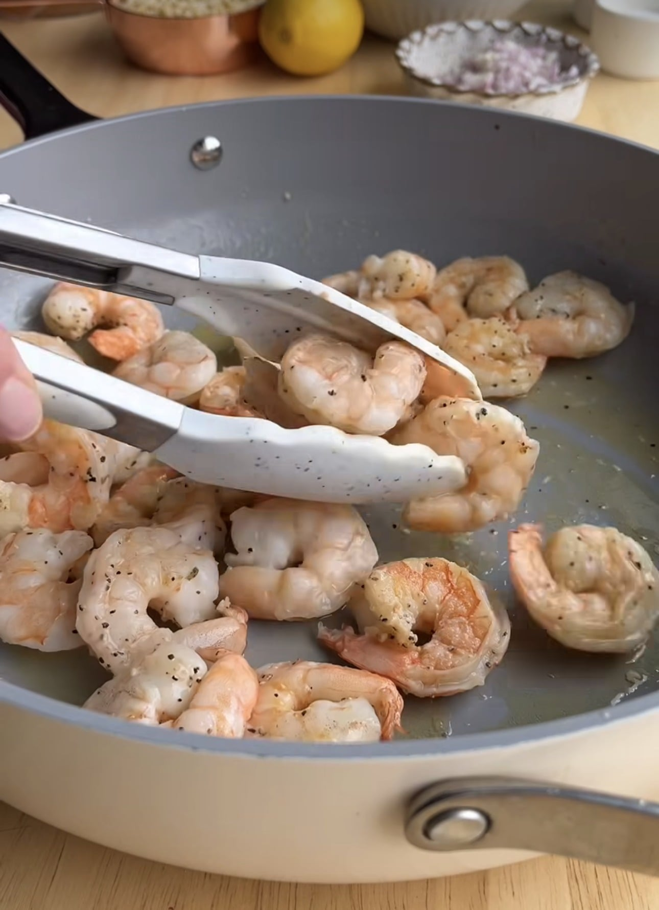
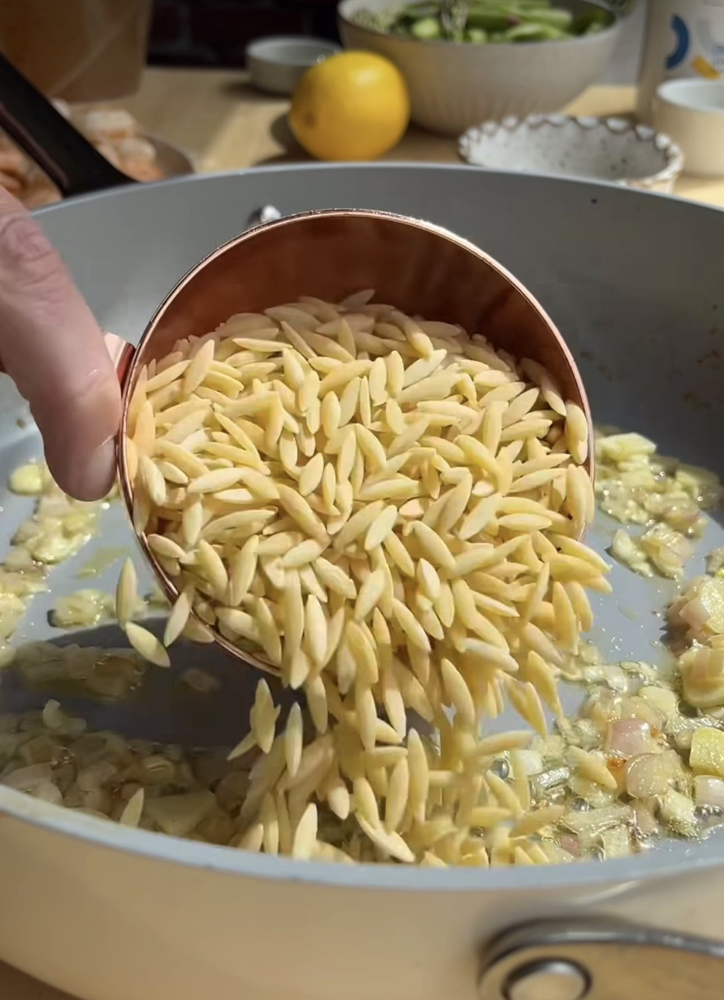
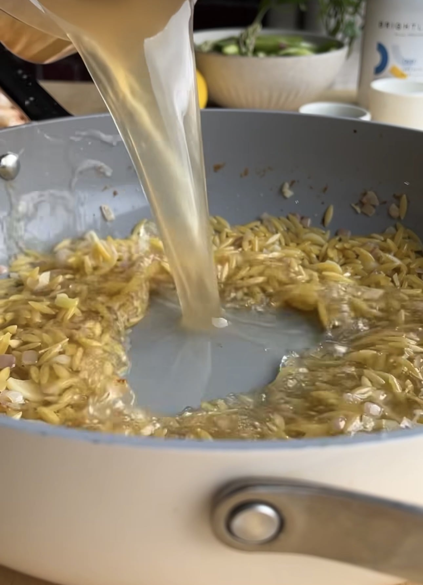
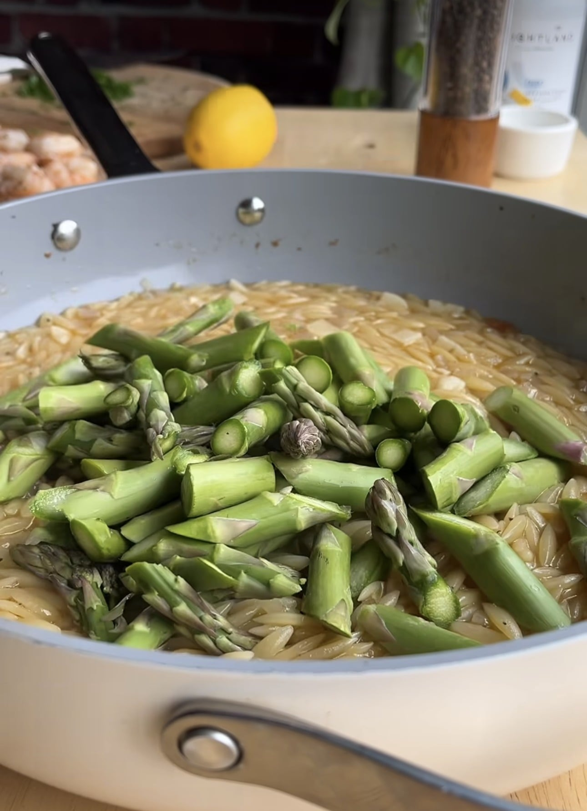
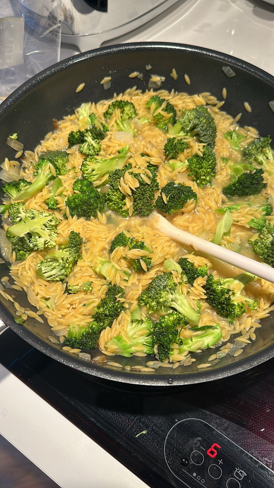
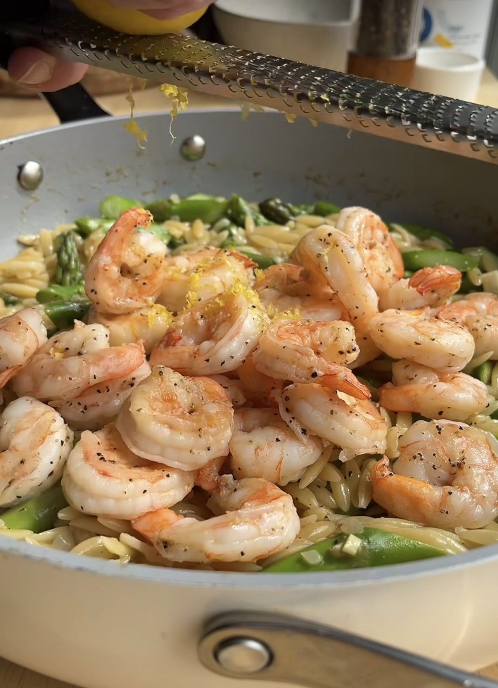
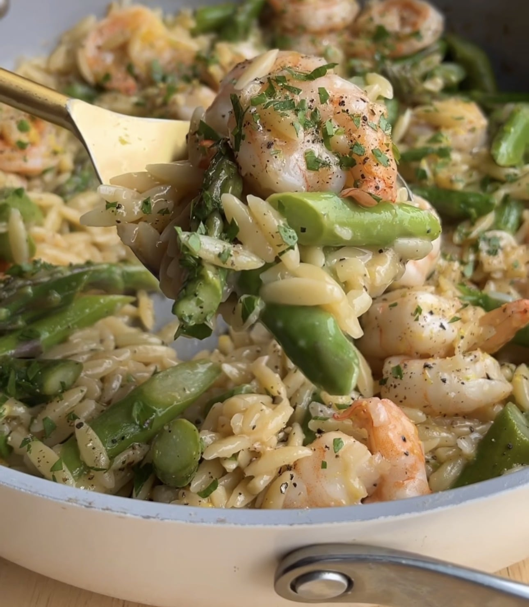

## Zutaten
- {{500 g}} Garnelen, geschält
- {{1}} Schalotte, fein gewürfelt
- {{3}} Knoblauchzehen, gehackt
- {{300 g}} Orzo (Kritharaki)
- {{750 ml}} Gemüsebrühe
- {{500 g}} grüner Spargel, in Stücke geschnitten
- {{1}} Bio-Zitrone (Abrieb und Saft)
- {{1/2 Bund}} Petersilie, gehackt
- Olivenöl, Salz, Pfeffer

## Equipment
- Große Pfanne mit Deckel

## Zubereitung
1. **Garnelen anbraten:** Garnelen mit Salz und reichlich Pfeffer würzen und in etwas Olivenöl bei mittlerer bis hoher Hitze ca. 1–2 Min. pro Seite braten, bis sie rosa sind. Herausnehmen.
   
2. **Orzo anrösten:** Etwas Olivenöl in die Pfanne geben, Schalotte und Knoblauch ca. 2 Min. andünsten. Orzo dazugeben und ca. 1 Min. mitrösten.
   
3. **Köcheln lassen:** Brühe angießen, aufkochen und zugedeckt bei mittlerer Hitze ca. 8 Min. köcheln lassen, dabei gelegentlich umrühren.
   
4. **Spargel garen:** Spargel auf den Orzo geben und zugedeckt weitere ca. 4–5 Min. garen, bis der Orzo die Brühe aufgenommen hat und der Spargel bissfest ist.
   
   
5. **Abschmecken:** Garnelen zurück in die Pfanne geben, Zitronenschale darüberreiben, Zitronensaft dazugeben und alles mit Salz und Pfeffer abschmecken.
   
6. **Servieren:** Mit Petersilie bestreuen und direkt aus der Pfanne servieren.
   

## Tipps
- Mengen geschätzt.
- Auch vorzüglich mit weißem Kabeljau oder anderem weißen Fisch ohne Gräten statt Garnelen.
- Statt Spargel schmeckt auch Brokkoli.
