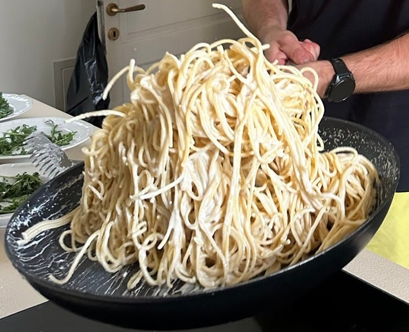

## Zutaten
- {{400 g}} Spaghetti
- {{500 g}} grüner Spargel, in Stücken
- {{2}} Bio-Zitronen (Abrieb und Saft)
- {{150 ml}} Sahne
- {{60 g}} Parmesan, fein gerieben, plus etwas zum Bestreuen
- {{100 g}} Rucola
- {{50 g}} Cashewkerne
- Olivenöl, Salz, Pfeffer

## Equipment
- Großer Topf
- Große Pfanne

## Zubereitung
1. **Pasta kochen:** Spaghetti in reichlich Salzwasser nach Packungsangabe al dente kochen. Ca. {{200 ml}} Nudelwasser aufheben.
2. **Spargel braten:** Spargel in etwas Olivenöl bei mittlerer Hitze ca. 5 Min. bissfest braten, salzen und herausnehmen.
3. **Cashews rösten:** Cashewkerne ohne Fett ca. 3 Min. goldbraun rösten und grob zerdrücken.
4. **Soße mischen:** Sahne, Zitronenabrieb und -saft in der Pfanne erwärmen, Parmesan einrühren und mit Salz und Pfeffer würzen. Spaghetti und Spargel dazugeben und mit etwas Nudelwasser schwenken, bis die Soße cremig ist.
   
5. **Servieren:** Rucola auf Teller verteilen, Pasta daraufgeben, mit Parmesan und den Cashews bestreuen.

## Tipps
- Mengen geschätzt.
