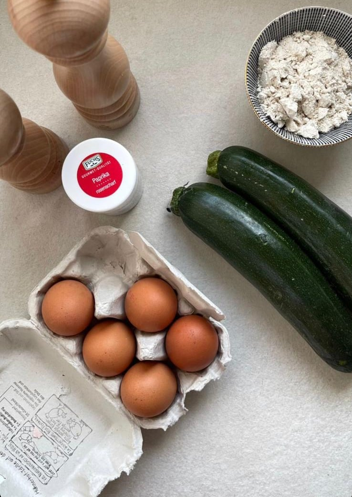
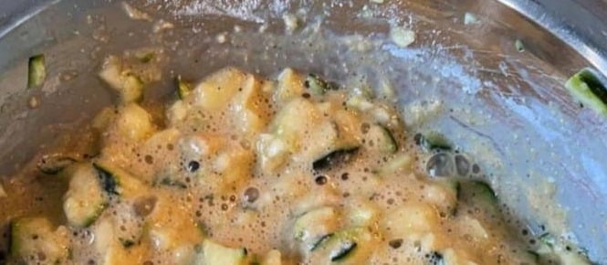

## Zutaten
- {{2}} große Zucchini (oder 3 kleine)
- {{5}} Eier
- {{2}} Frühlingszwiebeln (oder 1/2 Zwiebel), fein geschnitten
- {{3 EL}} Mehl oder gemahlene Haferflocken, gehäuft
- Olivenöl, Salz, Pfeffer, Paprikapulver (rosenscharf)

## Equipment
- Reibe
- Große Pfanne

## Zubereitung
1. **Zucchini raspeln:** Zucchini grob raspeln.
   
2. **Teig mischen:** Zucchini, Eier und Frühlingszwiebeln verquirlen, mit Salz, Pfeffer und Paprikapulver würzen. Mehl dazugeben und alles gut vermischen.
   
3. **Ausbacken:** Öl in der Pfanne erhitzen, kleine Puffer formen und von jeder Seite ca. 3–4 Min. goldbraun braten. Auf Küchenpapier abtropfen lassen.
4. **Servieren:** Warm servieren, z. B. mit gekörntem Frischkäse mit Zitrone.

## Tipps
- Portionen geschätzt.
