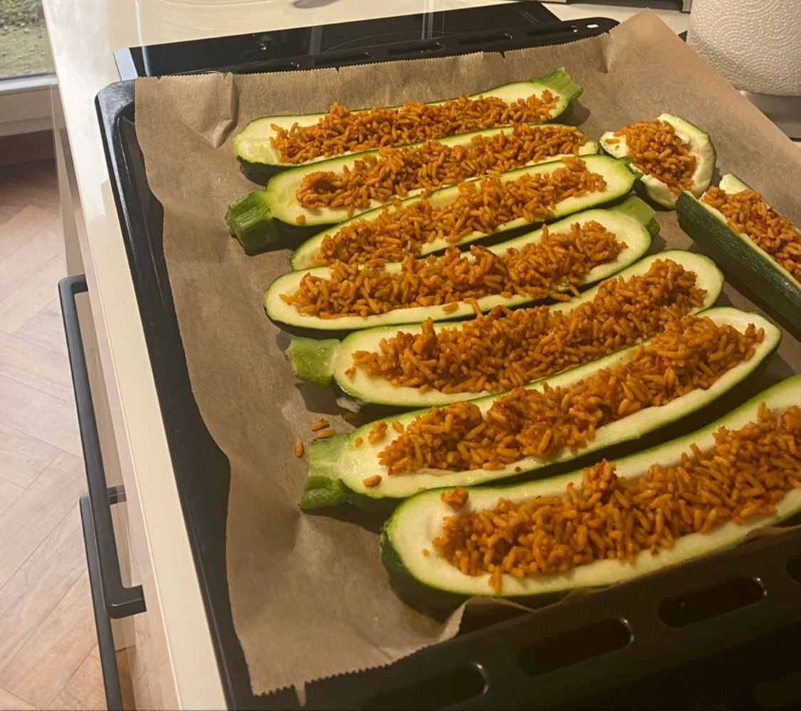
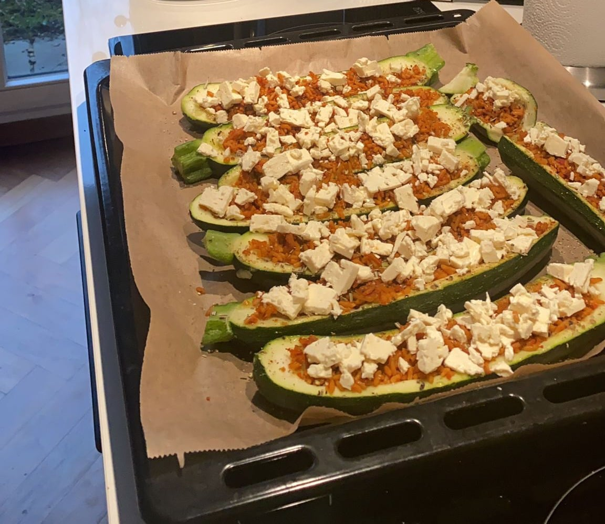

## Zutaten
- {{2}} große Zucchini
- {{250 g}} gekochter Reis (vom Vortag oder Express-Reis)
- {{2 EL}} Tomatenmark
- {{150 g}} Hirtenkäse, zerbröselt
- {{1 EL}} Olivenöl
- Salz, Pfeffer, Paprikapulver, getrockneter Rosmarin

## Equipment
- Backblech mit Backpapier

## Zubereitung
1. **Ofen vorheizen:** Backofen auf 200 °C Ober-/Unterhitze vorheizen.
2. **Zucchini aushöhlen:** Zucchini längs halbieren und das Innere mit einem Löffel herauskratzen (für eine Soße oder Suppe aufheben).
3. **Füllen:** Reis mit Tomatenmark, Paprikapulver, Salz und Pfeffer mischen und in die Zucchinihälften füllen. Hirtenkäse darüberbröseln, mit Rosmarin bestreuen und mit Olivenöl beträufeln.
   
   
4. **Backen:** Ca. 20 Min. backen, bis der Käse goldbraun ist.
5. **Servieren:** Schiffchen mit Pfeffer übermahlen und servieren.

## Tipps
- Mengen geschätzt.
